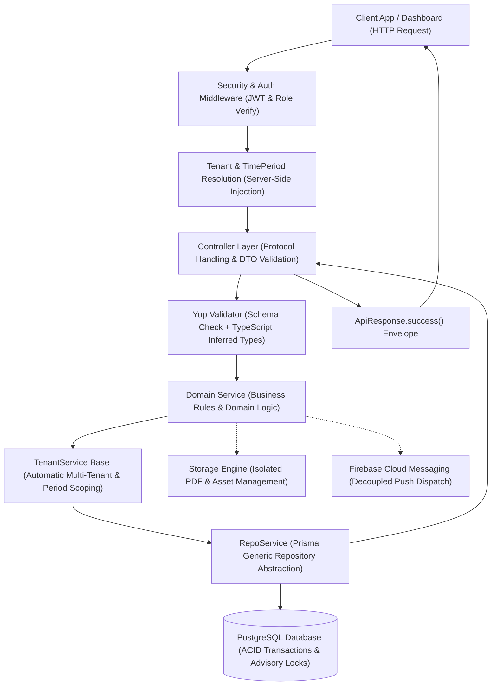

# 🏛️ Enterprise Multi-Tenant Educational Core Backend
## Architectural Blueprint, Design Patterns & Engineering Specification

[](https://nodejs.org/)
[](https://www.typescriptlang.org/)
[](https://expressjs.com/)
[](https://www.prisma.io/)
[](https://www.postgresql.org/)
[](https://owasp.org/)
[](#architectural-flow)

---

> ### 📌 بيان السرية وحماية الملكية الفكرية (Confidentiality & Compliance Notice)
> تم إعداد هذا المستند كمرجع معماري وتقني موجه لفرق التوظيف التقني (**Technical Recruiters**)، والمهندسين الرواد (**Tech Leads**)، ومدراء الفرق الهندسية (**Engineering Managers**). 
> **لا يحتوي هذا المستند على أي بيانات اعتماد (Credentials)، أو مفاتيح سرية (Secrets)، أو عناوين خوادم حقيقية، أو بيانات عملاء.** كافة الشيفرات البرمجية المرفقة تم تجريدها وتطهيرها (Sanitized) لتمثيل الأنماط الهندسية والمعمارية المتبعة فقط.

---

## 📑 فهرس المحتويات (Table of Contents)
1. [نظرة عامة على النظام (System Executive Summary)](#1-نظرة-عامة-على-النظام-system-executive-summary)
2. [التدفق المعماري الشامل (End-to-End Architectural Flow)](#2-التدفق-المعماري-الشامل-end-to-end-architectural-flow)
3. [هيكلية المجلدات والمشروع (Codebase Anatomy & Directory Structure)](#3-هيكلية-المجلدات-والمشروع-codebase-anatomy--directory-structure)
4. [الركائز الهندسية وأنماط التصميم (Core Architectural Pillars & Patterns)](#4-الركائز-الهندسية-وأنماط-التصميم-core-architectural-pillars--patterns)
   - [4.1 معمارية عزل المستأجرين والفترات (Zero-Trust Multi-Tenancy & Temporal Scoping)](#41-معمارية-عزل-المستأجرين-والفترات-zero-trust-multi-tenancy--temporal-scoping)
   - [4.2 تسلسل وراثة الخدمات ثلاثي الطبقات (3-Tier Service Inheritance Hierarchy)](#42-تسلسل-وراثة-الخدمات-ثلاثي-الطبقات-3-tier-service-inheritance-hierarchy)
   - [4.3 أقفال التزامن ودورة ترحيل الفصول (PostgreSQL Advisory Locks & Atomic Rollover)](#43-أقفال-التزامن-ودورة-ترحيل-الفصول-postgresql-advisory-locks--atomic-rollover)
   - [4.4 التحقق الصارم واستنتاج الأنواع (Type-Safe Validation & DTO Inference)](#44-التحقق-الصارم-واستنتاج-الأنواع-type-safe-validation--dto-inference)
   - [4.5 نمط التوكيد الحارس والتضييق النوعي (Defensive Assertion Guards & Type Narrowing)](#45-نمط-التوكيد-الحارس-والتضييق-النوعي-defensive-assertion-guards--type-narrowing)
   - [4.6 غلاف الاستجابة الموحد وإدارة الأخطاء (Unified API Envelope & Error Boundary)](#46-غلاف-الاستجابة-الموحد-وإدارة-الأخطاء-unified-api-envelope--error-boundary)
   - [4.7 النمذجة الأكاديمية وقواعد النطاق (Academic Domain Modeling & Business Rules)](#47-النمذجة-الأكاديمية-وقواعد-النطاق-academic-domain-modeling--business-rules)
   - [4.8 منظومة الإشعارات اللاتزامنية (Decoupled Push Notification Subsystem)](#48-منظومة-الإشعارات-اللاتزامنية-decoupled-push-notification-subsystem)
5. [مصفوفة القرارات الهندسية (Architectural Decision Records - ADR)](#5-مصفوفة-القرارات-الهندسية-architectural-decision-records---adr)
6. [معايير جودة الكود والأداء (Code Quality & Performance Engineering)](#6-معايير-جودة-الكود-والأداء-code-quality--performance-engineering)

---

## 1. نظرة عامة على النظام (System Executive Summary)

هذا المشروع يمثل **النواة الخلفية (Backend Core)** لمنصة سحابية متعددة المستأجرين (**Multi-Tenant SaaS**) مخصصة لإدارة وتوزيع المحتوى التعليمي للمكتبات الجامعية، والأكاديميات، والمراكز التعليمية.

### التحديات الهندسية الرئيسية التي يعالجها النظام:
* **عزل البيانات الصارم (Zero-Trust Isolation)**: استضافة مئات المكتبات التعليمية على بنية تحتية وقاعدة بيانات موحدة (**Shared Database, Shared Schema**) مع استحالة تسرب البيانات بين المستأجرين على مستوى المنطق البرمجي.
* **البعد الزمني المزدوج (Temporal Context)**: كل مستأجر يمتلك دورات وفصول زمنية مستقلة (`TimePeriods`)؛ العمليات التشغيلية تستهدف الفترة النشطة تلقائياً دون الحاجة لتمرير معرفاتها يدوياً، مع دعم استعراض الفترات التاريخية والمؤرشفة بشكل آمن.
* **إدارة التزامن الفائق والترحيل الذري (Atomic Rollover)**: انتقال الفصول الدراسية وتصفير أو أرشفة آلاف الاشتراكات وحذف المحتوى منتهي الصلاحية ضمن **Database Transaction** واحدة محصنة بأقفال موزعة (**Advisory Locks**) تمنع حدوث Race Conditions.
* **أداء فائق وتكامل كتابي كامل (End-to-End Type Safety)**: استخدام **TypeScript** الصارم من طبقة التحقق من المدخلات وصولاً إلى استعلامات قاعدة البيانات، مع منع كتابة استعلامات مكررة أو دوال تحقق يدوية مهدرة للوقت.

---

## 2. التدفق المعماري الشامل (End-to-End Architectural Flow)

يسير أي طلب وارد للنظام وفق خط سير معقم ومحدد بدقة (Deterministic Lifecycle)، حيث تخضع كل مرحلة لمسؤولية واحدة فقط (**Single Responsibility Principle**):



---

## 3. هيكلية المجلدات والمشروع (Codebase Anatomy & Directory Structure)

تم تنظيم المشروع باتباع مبادئ **Clean Architecture** و **Domain-Driven Design (DDD)**، مما يجعل المشروع قابلاً للتوسع وإضافة وحدات نطاق جديدة بسهولة وسرعة:

```text
backend/
├── prisma/
│   ├── schema.prisma              # مخطط قاعدة البيانات والعلاقات والفهارس المركبة
│   ├── migrations/                # سجل ترحيلات SQL المؤتمتة
│   └── seed.ts                    # بذور البيانات الأولية (Roles, Initial Entities)
│
├── src/
│   ├── common/                    # الأدوات المشتركة والعابرة للنطاقات (Cross-Cutting Concerns)
│   │   ├── errors/
│   │   │   ├── Ensure.handler.ts  # أداة التوكيد الصارم وحراسة الأنواع (Assertion Guards)
│   │   │   ├── ErrorMessages.ts   # قاموس الأخطاء المترجم والمعياري (i18n Ready)
│   │   │   ├── http.error.ts      # تصنيفات أخطاء HTTP (400, 401, 403, 404, 409...)
│   │   │   ├── error.handler.ts   # Express Global Error Boundary Middleware
│   │   │   └── validator.ts       # محرك فحص مخططات Yup وربط رسائل الخطأ
│   │   └── responses/
│   │       └── api.response.ts    # غلاف الاستجابة القياسي الموحد (ApiResponse)
│   │
│   ├── config/                    # الإعدادات العامة للبيئات وقواعد البيانات
│   │   ├── prisma.ts              # النسخة الأحادية (Singleton) لعميل Prisma
│   │   └── environment.ts         # قراءة المتغيرات البيئية وفحصها
│   │
│   ├── types/                     # توسيع الأنواع العالمية وسياقات المستأجر
│   │   ├── express.d.ts           # توسيع Request لإضافة user و tenant Context
│   │   └── tenant.context.ts      # واجهة TenantContext المعمارية
│   │
│   ├── middlewares/               # طبقة الاعتراض البرمجي والأمان
│   │   ├── auth.middleware.ts     # فك تشفير الـ JWT والتحقق من صحة المستخدم
│   │   ├── tenant.middleware.ts   # الاستخراج الآمن لسياق المستأجر والفترة النشطة
│   │   ├── role.middleware.ts     # التحقق من الصلاحيات (RBAC: Super Admin / Library Admin)
│   │   └── checkUserStatus.ts     # حظر الحسابات المعطلة لحظياً
│   │
│   ├── dto/                       # كائنات نقل البيانات والمخططات التحققية (Yup Schemas)
│   │   ├── auth.dto.ts
│   │   ├── content/               # مخططات المحتوى (Lectures, Gold, Summaries, Courses)
│   │   ├── student.dto.ts
│   │   ├── subscription.dto.ts
│   │   └── time-period.dto.ts
│   │
│   ├── services/                  # طبقة منطق الأعمال والوصول للبيانات (Business Logic Layer)
│   │   ├── repo.service.ts        # تجريد Prisma العام للعمليات الجينيريك (Base Repository)
│   │   ├── tenant.service.ts      # نواة عزل المستأجر والفترة آلياً (Multi-Tenant Scoper)
│   │   ├── storage/               # إدارة الملفات الفيزيائية وسلامة الأقراص
│   │   └── domain/                # خدمات النطاق الوظيفية المستقلة (20+ Domain Services)
│   │       ├── academic-year.service.ts
│   │       ├── branch.service.ts
│   │       ├── department.service.ts
│   │       ├── lecture.service.ts
│   │       ├── gold.service.ts
│   │       ├── summary.service.ts
│   │       ├── course.service.ts
│   │       ├── question-bank.service.ts
│   │       ├── subscription.service.ts
│   │       ├── time-period.service.ts
│   │       └── notification.service.ts
│   │
│   ├── controllers/               # معالجة بروتوكول HTTP وإرجاع ApiResponse
│   ├── routes/                    # تسجيل المسارات وربط الحراس (Guards)
│   └── index.ts                   # نقطة تشغيل الخادم وتأمين منافذ الاتصال
│
├── package.json
└── tsconfig.json                  # إعدادات المترجم الصارمة (Strict Mode Enabled)
```

---

## 4. الركائز الهندسية وأنماط التصميم (Core Architectural Pillars & Patterns)

### 4.1 معمارية عزل المستأجرين والفترات (Zero-Trust Multi-Tenancy & Temporal Scoping)

#### المعضلة الهندسية:
في الأنظمة متعددة المستأجرين، أخطر خطأ هو **تسرب البيانات (Cross-Tenant Data Leakage)** نتيجة نسيان المطور تضمين شرط `where: { libraryId }` في استعلام معين، أو ثقة الخادم بمعرف `libraryId` قادم في جسم الطلب (`req.body`) من مستخدم خبيث.

#### الحل المعماري المتبع (Zero-Trust Architecture):
1. **انعدام الثقة التام بالعميل**: يمنع منعاً باتاً قراءة `libraryId` أو `timePeriodId` من الـ `req.body` للعمليات التشغيلية.
2. **الاستخراج الحصري من السيرفر**: يقوم `authMiddleware` بالتحقق من الـ JWT واستخراج هوية المستخدم ومكتبته، ثم يقوم `tenantMiddleware` بالاستعلام عن **الفترة النشطة حالياً للمكتبة (`status: 'ACTIVE'`)**، وحقنهما في كائن `req.tenant`:

```typescript
export interface TenantContext {
  libraryId: string;
  timePeriodId?: string;
  isSuperAdmin?: boolean;
}
```

3. **الحقن التلقائي في طبقة الخدمة**: تتولى `TenantService` اعتراض كافة عمليات القراءة والكتابة ودمج `libraryId` و `timePeriodId` في الاستعلامات آلياً دون أي تدخل بشري.

---

### 4.2 تسلسل وراثة الخدمات ثلاثي الطبقات (3-Tier Service Inheritance Hierarchy)

تم بناء طبقة الخدمات بأسلوب برمجة كائنية متقدم يجمع بين **Generics** و **Inheritance** لتحقيق مبدأ **DRY (Don't Repeat Yourself)** وتفادي تكرار الأكواد في عشرات الجداول.

```text
┌──────────────────────────────────────────────────────────┐
│           RepoService<T> (Generic Data Layer)            │
│  - Generic CRUD: create, update, delete, getById, getAll │
│  - Pagination math & Metadata computation                │
│  - Automatic 'Ensure.exists' on entity lookup            │
└────────────────────────────┬─────────────────────────────┘
                             │ extends
                             ▼
┌──────────────────────────────────────────────────────────┐
│          TenantService<T> (Multi-Tenant Scoper)          │
│  - Automatic Query Interception:                         │
│      where.libraryId = context.libraryId                 │
│      where.timePeriodId = context.timePeriodId           │
│  - Data Scoping for Writes & Bulk Inserts                │
│  - Zero Data-Leakage Guarantee                           │
└────────────────────────────┬─────────────────────────────┘
                             │ extends
                             ▼
┌──────────────────────────────────────────────────────────┐
│      Domain Services (e.g., LectureService, Course...)   │
│  - Pure Domain Logic & Business Validations              │
│  - Direct Clean Calls: this.create(dto), this.findMany() │
│  - Complete Decoupling from Boilerplate Multi-Tenancy    │
└──────────────────────────────────────────────────────────┘
```

#### نموذج الكود البرمجي المجرد لتطبيق الطبقة:

```typescript
// Base Repo Layer
export class RepoService<T = any> {
  constructor(protected modelName: keyof PrismaClient, protected entityName: string) {}

  protected get model(): any {
    return (prisma as any)[this.modelName];
  }

  async getById(id: string): Promise<T> {
    const existing = await this.model.findUnique({ where: { id } });
    Ensure.exists(existing, this.entityName);
    return existing;
  }
}

// Multi-Tenant Isolation Layer
export class TenantService<T = any> extends RepoService<T> {
  constructor(
    modelName: keyof PrismaClient,
    entityName: string,
    protected tenantContext: TenantContext,
    protected isPeriodScoped: boolean = true
  ) {
    super(modelName, entityName);
  }

  protected buildTenantWhere(where: any = {}): any {
    return {
      ...where,
      ...(this.tenantContext.libraryId && { libraryId: this.tenantContext.libraryId }),
      ...(this.isPeriodScoped && this.tenantContext.timePeriodId && { 
        timePeriodId: this.tenantContext.timePeriodId 
      }),
    };
  }

  override async create(data: any): Promise<T> {
    Ensure.forbidden(!!this.tenantContext.libraryId || !!this.tenantContext.isSuperAdmin, "Unauthorized Library Scope");
    const scopedData = {
      ...data,
      libraryId: this.tenantContext.libraryId,
      ...(this.isPeriodScoped && { timePeriodId: this.tenantContext.timePeriodId })
    };
    return await super.create(scopedData);
  }

  override async getAll(options?: { where?: any; include?: any }): Promise<T[]> {
    const scopedWhere = this.buildTenantWhere(options?.where);
    return await super.getAll({ ...options, where: scopedWhere });
  }
}

// Concrete Domain Service Example
export class LectureService extends TenantService<Lecture> {
  constructor(tenantContext: TenantContext) {
    super("lecture", "Lecture", tenantContext, true); // True: period-scoped
  }

  async createLecture(dto: CreateLectureDto) {
    // Notice: No manual libraryId or timePeriodId injection needed!
    // TenantService handles it transparently and securely.
    return await this.create({
      title: dto.title,
      subjectId: dto.subjectId,
      price: dto.price,
    });
  }
}
```

---

### 4.3 أقفال التزامن ودورة ترحيل الفصول (PostgreSQL Advisory Locks & Atomic Rollover)

#### المعضلة الهندسية:
عند فتح فصل دراسي جديد لمكتبة ما (Semester Rollover)، يتطلب النظام:
1. أرشفة الفصل السابق وتحويل حالته إلى `ARCHIVED`.
2. نقل آلاف اشتراكات الطلاب الحالية إلى جدول أرشيف الاشتراكات (`subscription_archives`) كلقطة غير قابلة للتعديل للحفاظ على التاريخ المالي، ثم حذفها من الجداول التشغيلية.
3. تفريغ وحذف المحاضرات والملخصات والأوراق الذهبية والكورسات السابقة وملفاتها الفيزيائية من القرص.
4. الإبقاء التلقائي على بنك الأسئلة ونقله للفترة الجديدة.

**المخاطرة:** إذا ضغط مدير المكتبة على زر الترحيل مرتين بالتزامن، أو تم استدعاء الطلب بواسطة عمليتين متوازيتين، قد تنشأ فترتان نشطتان في نفس الوقت أو يحصل تضارب بيانات (Race Condition) كارثي.

#### الحل المعماري المتبع:
* استخدام **PostgreSQL Advisory Locks** على مستوى المعاملة (`pg_advisory_xact_lock`) باستخدام بصمة رقمية لمُعرّف المكتبة `hashtext(libraryId)`.
* تنفيذ كامل العملية داخل **Prisma Interactive Transaction** مع رفع المهلة الزمنية لضمان الاكتمال الذري (Atomicity).
* تأجيل حذف الملفات الفيزيائية من القرص لما بعد نجاح الـ Transaction لضمان عدم فقدان أي ملف إذا حدث Rollback.

```typescript
async createPeriod(dto: CreateTimePeriodDto) {
  const libraryId = this.requireLibraryId();

  // 1. Transaction execution with PostgreSQL distributed advisory lock
  const { newPeriod, storageKeysToDelete } = await prisma.$transaction(
    async (tx) => {
      // Prevents concurrent rollover operations for the same library
      await tx.$executeRaw`SELECT pg_advisory_xact_lock(hashtext(${libraryId}))`;

      const previous = await tx.timePeriod.findFirst({
        where: { libraryId, status: PeriodStatus.ACTIVE },
      });

      const created = await tx.timePeriod.create({
        data: {
          libraryId,
          name: dto.name.trim(),
          startDate: new Date(dto.startDate),
          status: PeriodStatus.ACTIVE,
        },
      });

      if (previous) {
        // Archive previous period
        await tx.timePeriod.update({
          where: { id: previous.id },
          data: { status: PeriodStatus.ARCHIVED, endDate: new Date() },
        });

        // Archive subscriptions snapshot & purge outdated period content
        await this.archivePeriodSubscriptions(tx, libraryId, previous);
        const purgeResult = await this.purgePeriodContent(tx, libraryId, previous.id);
        
        // Retain question bank items and transfer to the new period
        await tx.questionBankItem.updateMany({
          where: { libraryId, timePeriodId: previous.id },
          data: { timePeriodId: created.id },
        });

        return { newPeriod: created, storageKeysToDelete: purgeResult.storageKeys };
      }

      return { newPeriod: created, storageKeysToDelete: [] };
    },
    { timeout: 120_000, maxWait: 10_000 }
  );

  // 2. Physical storage files are deleted ONLY AFTER transaction successfully commits
  await this.deletePhysicalFiles(storageKeysToDelete);

  return newPeriod;
}
```

---

### 4.4 التحقق الصارم واستنتاج الأنواع (Type-Safe Validation & DTO Inference)

بدلاً من كتابة تعريف الـ Interface يدوياً في TypeScript ثم إعادة كتابة شروط التحقق في مكتبة خارجية، تم تطبيق نمط **Single Source of Truth** بالاعتماد على **Yup**:

```typescript
import * as yup from "yup";

// Schema definition
export const createLectureSchema = yup.object({
  title: yup.string().required("اسم المحاضرة مطلوب").trim().min(3),
  description: yup.string().optional().trim(),
  subjectId: yup.string().uuid("معرف المادة غير صالح").required("المادة مطلوبة"),
  price: yup.number().min(0, "السعر لا يمكن أن يكون سالباً").default(0),
});

// Automatic compile-time Type Inference (Zero redundancy!)
export type CreateLectureDto = yup.InferType<typeof createLectureSchema>;
```

#### دور وحدة التحكم النحيفة (Thin Controller):
لا تحتوي الـ Controllers على أي استعلامات لقاعدة البيانات أو منطق أعمال، وتقتصر مهمتها على استقبال الطلب، التحقق من المخطط، توجيه البيانات للخدمة، وإرجاع النتيجة:

```typescript
export class LectureController {
  static create = async (req: Request, res: Response, next: NextFunction) => {
    try {
      // Validate schema & infer typed DTO
      const dto = await validator<CreateLectureDto>(createLectureSchema, req.body);
      
      // Inject secure tenant context
      const lectureService = new LectureService(req.tenant!);
      const result = await lectureService.createLecture(dto, req.file);

      // Deterministic API Response Envelope
      return res.status(201).json(
        ApiResponse.success(result, "تم رفع المحاضرة بنجاح")
      );
    } catch (error) {
      next(error); // Delegated to Global Error Middleware
    }
  };
}
```

---

### 4.5 نمط التوكيد الحارس والتضييق النوعي (Defensive Assertion Guards & Type Narrowing)

للتخلص من تكرار كتل `if (!item) throw new NotFoundError(...)` التي تجعل الكود غير مقروء، تم تصميم كلاس التوكيد الحارس `Ensure` مستفيداً من ميزة **TypeScript Assertion Signatures (`asserts value is NonNullable<T>`)**:

```typescript
export class Ensure {
  /**
   * Asserts that a value is neither null nor undefined.
   * Compiler narrows the type from (T | null | undefined) to T automatically!
   */
  static exists<T>(
    value: T, 
    entityName: string, 
    customMessage?: string
  ): asserts value is NonNullable<T> {
    if (!value) {
      throw new NotFoundError(
        customMessage || ErrorMessages.generateErrorMessage(entityName, "not found", "ar")
      );
    }
  }

  static required(value: any, fieldName: string): void {
    if (value === undefined || value === null || value === "") {
      throw new BadRequestError(`${fieldName} مطلوب`);
    }
  }

  static forbidden(condition: boolean, message: string): void {
    if (!condition) {
      throw new ForbiddenError(message);
    }
  }
}
```

#### كيف يخدم هذا النمط المطور والـ Compiler معاً:
```typescript
const student = await this.studentRepo.findById(id); 
// نوع المتغير هنا: Student | null

Ensure.exists(student, "Student"); 
// بعد هذا السطر مباشرة، يفهم TypeScript تلقائياً أن المتغير أصح: Student فقط!
// وتم التخلص من أي فحص إضافي بدون كسر معايير الـ Null-Safety.
```

---

### 4.6 غلاف الاستجابة الموحد وإدارة الأخطاء (Unified API Envelope & Error Boundary)

تلتزم جميع مسارات الخادم بإرجاع صيغة استجابة JSON موحدة يسهل على تطبيقات الويب والموبايل استهلاكها والتنبؤ بها:

#### 1. استجابة العمليات الناجحة مع بيانات الصفحات (Pagination):
```json
{
  "success": true,
  "message": "تم جلب البيانات بنجاح",
  "data": [ ... ],
  "meta": {
    "total": 240,
    "page": 1,
    "limit": 10,
    "totalPages": 24
  }
}
```

#### 2. معالجة الأخطاء الشاملة (Global Error Handling Middleware):
يقوم الـ Middleware باعتراض كافة الأخطاء البرمجية الناتجة عن الـ Runtime أو الـ Business Exceptions، وتحويلها إلى استجابات HTTP قياسية مع تشفير رسائل الأخطاء في بيئة الإنتاج لمنع تسريب تفاصيل الخادم الداخلية (Information Leakage):

```typescript
export const errorHandler = (err: any, req: Request, res: Response, next: NextFunction) => {
  const statusCode = err.statusCode || (err.name === "ValidationError" ? 400 : 500);
  const message = err.message || "حدث خطأ غير متوقع في الخادم";

  // Structured Logging for observability
  logger.error(`[${req.method}] ${req.originalUrl} >> Status: ${statusCode} >> Error: ${message}`, {
    stack: process.env.NODE_ENV === "development" ? err.stack : undefined,
  });

  return res.status(statusCode).json(
    ApiResponse.error(message, err.errors || undefined)
  );
};
```

---

### 4.7 النمذجة الأكاديمية وقواعد النطاق (Academic Domain Modeling & Business Rules)

تم بناء وتصميم قاعدة البيانات لتجسيد الهيكل الأكاديمي للجامعات والمكتبات دون تعقيد غير مبرر:

#### 1. التسلسل الهرمي الأكاديمي المرن:
$$\text{Library} \longrightarrow \text{Branch} \longrightarrow \text{Department (Optional)} \longrightarrow \text{Academic Year} \longrightarrow \text{Subject}$$
* **دعم الفروع ذات الأقسام وبدونها**: يحتوي جدول الفروع على مؤشر `hasDepartments`. إذا كان `true`، يُلزم النظام الطالب باختيار قسم أكاديمي، وإذا كان `false` يرتبط الطالب بالسنة الدراسية والمواد التابعة للفرع مباشرة دون قسم.
* **حظر مفهوم الشعب الأكاديمية (Zero-Sections Policy)**: لا يتبنى النظام مفهوم الشعب (Sections) إطلاقاً لمنع تشتت توزيع المحتوى واشتراكات الطلاب.

#### 2. الميزات التعليمية الخمس المستقلة (5 Specialized Content Engines):
تم فصل المواد التعليمية إلى 5 محركات مستقلة في قواعد البيانات والخدمات بدلاً من وضعها في جدول عام مبهم:
1. **المحاضرات (Lectures)**: اشتراك المادة يمنح الطالب وصولاً فورياً لكافة محاضرات المادة خلال الدورة.
2. **الأوراق الذهبية (Gold Papers)**: ملخصات امتحانية مكثفة ذات اشتراكات مستقلة.
3. **الملخصات (Summaries)**: مذكرات دراسية ونوتات تخصصية باشتراك مستقل.
4. **الكورسات المنظمة (Structured Courses)**: دورات مقسمة إلى دروس متسلسلة (`Course -> Lessons`) ذات وصول مقيد.
5. **بنك الأسئلة التفاعلي (Interactive Question Bank)**: بيانات تفاعلية مهيكلة (خيارات، إجابة صحيحة، شروحات توضيحية، درجات صعوبة) **وليس مجرد ملفات ثابتة**، مما يسمح بالاختبارات المؤتمتة الفورية.

---

### 4.8 منظومة الإشعارات اللاتزامنية (Decoupled Push Notification Subsystem)

* **قاعدة البيانات كمرجع وحيد للحقيقة (Single Source of Truth)**: يتم تسجيل الإشعار ومستلميه في PostgreSQL في جدولي `Notification` و `NotificationRecipient` لضمان إمكانية قراءة الطالب للإشعارات السابقة من صندوق الوارد (`Inbox`) في أي وقت.
* **فك الارتباط (Decoupling)**: إرسال الـ Push Notification عبر **Firebase Cloud Messaging (FCM)** يتم بشكل لاتزامني (`fire-and-forget`) دون تعطيل دورة إرجاع استجابة الـ HTTP الأصلية لرفع المحتوى أو تأكيد الاشتراك.
* **توجيه الروابط العميقة (Deep-Linking Metadata)**: يحتوي كل إشعار على حمولة بيانات موجهة (`featureType`, `subjectId`, `academicYearId`, `itemId`) تتيح لتطبيق الهاتف فتح الصفحة المعنية وتسليط الضوء على المحتوى المضاف تلقائياً.

---

## 5. مصفوفة القرارات الهندسية (Architectural Decision Records - ADR)

| القرار الهندسي | البديل الذي تم تجنبه | سبب الاختيار والدوافع المعمارية |
| :--- | :--- | :--- |
| **Prisma ORM** | TypeORM / Raw SQL | إنتاج استعلامات Type-Safe فائقة الأمان، سهولة إدارة الـ Migrations، وعلاقات ربط واضحة بدون الحاجة لكتابة Metadata مرهقة. |
| **PostgreSQL Advisory Locks** | Redis Distributed Locks (Redlock) | تجنب إضافة تبعيات بنية تحتية إضافية (Infrastructure Overhead)، واستغلال قوة وقفل المعاملات المدمج في PostgreSQL بكفاءة متناهية. |
| **Yup Type-Inference** | TypeScript Interfaces + Manual Checks | ضمان وجود مصدر حقيقة واحد فقط للبيانات (**Single Source of Truth**) ومنع حدوث أي Drift بين منطق التحقق والأنواع. |
| **Two-Tier Subscriptions (Live / Archive)** | Soft-Delete Flags (`isDeleted`) | عزل أداء الاستعلامات اليومية عن ملايين السجلات المؤرشفة القديمة، وتوفير سجل مالي وتاريخي غير قابل للتعديل (Immutable Audit Ledger). |
| **Inherited TenantService** | Manual Repository Queries | القضاء الجذري على إمكانية تسرب البيانات بين المستأجرين بنسبة 100% بحقن المعرفات برمجياً في الطبقة الأساسية. |

---

## 6. معايير جودة الكود والأداء (Code Quality & Performance Engineering)

1. **الالتزام الصارم بمبادئ SOLID**:
   - **S (Single Responsibility)**: فصل كامل بين الـ Routing، التحقق، المنطق الوظيفي، والوصول لقاعدة البيانات.
   - **O (Open/Closed)**: إمكانية إضافة خدمات نطاق جديدة بالوراثة من `TenantService` دون تعديل النواة المشتركة.
   - **L (Liskov Substitution)**: أي دالة تقبل `RepoService` تعمل بسلاسة مع `TenantService`.
   - **I (Interface Segregation)**: DTOs صغيرة ومخصصة لكل عملية (Create, Update, Filter).
   - **D (Dependency Inversion)**: الاعتماد على التجريدات والخدمات بدلاً من استدعاءات Prisma المباشرة في الـ Controllers.

2. **تحسين أداء قواعد البيانات (Database Performance & Optimization)**:
   - إنشاء **فهارس مركبة (Composite Indexes)** على الحقول الأكثر استعلاماً مثل `(libraryId, timePeriodId, isActive)`.
   - استخدام الـ Pagination الإجباري في جميع استعلامات القوائم عبر `getAllWithPagination` لمنع استهلاك الذاكرة.
   - تشغيل الـ Connection Pooling للاستفادة القصوى من موارد الخادم في أوقات الذروة.

3. **الأمان الدفاعي (Defensive Security Engineering)**:
   - حماية الخادم بحزم **Helmet** لإدارة ترويسات الـ HTTP الأمنية.
   - تطبيق **Rate Limiting** للوقاية من هجمات الـ Brute Force وحجب الخدمة (DDoS).
   - إخفاء الـ Stack Traces التفصيلية عن العميل النهائي خارج بيئة التطوير.
   - تشفير كلمات المرور باستخدام خوارزمية **Bcrypt** مع Salt Rounds مدروسة لموازنة الأمان والأداء.

---

## 👨‍💻 الخلاصة الهندسية للمسؤولين التقنيين (Summary for Recruiters & Leads)

> يجسد هذا المستودع نموذجاً واقعياً لكيفية بناء أنظمة سحابية مؤسساتية معقدة (**Enterprise-Grade Multi-Tenant Systems**) باستخدام **Node.js** و **TypeScript**. 
> تم مراعاة أعلى معايير هندسة البرمجيات: من أمان عزل البيانات ومنع الـ Race Conditions، إلى نظافة الكود وفصل الطبقات واستخدام تقنيات التحقق واستنتاج الأنواع المتقدمة.

---
**Prepared with engineering discipline & architectural rigor.**

